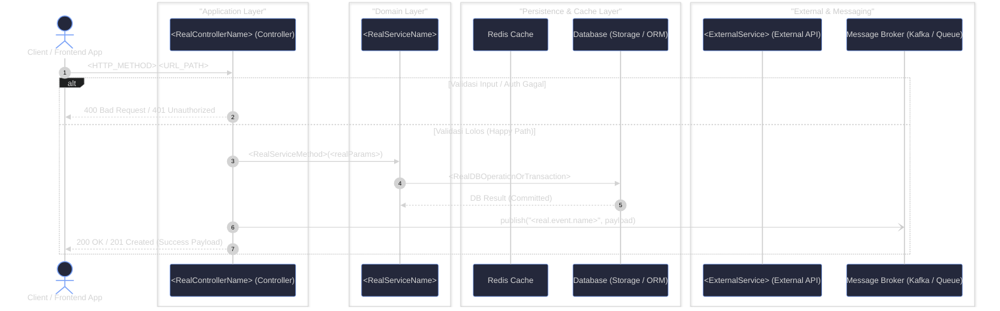
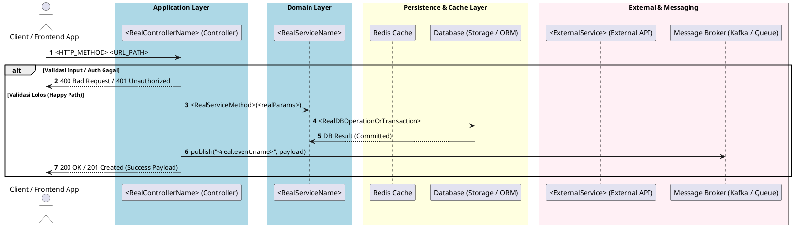

# UML-Architect Skill Instructions (Gemini 4 Argon Engine)

Instruksi ini mengatur AI Agent agar menghasilkan output analisis arsitektur dan diagram UML berstandar emas, anti-halusinasi (*zero-hallucination*), serta **100% konsisten** dengan engine deterministik UML-Architect MCP Server.

---

## 1. Protokol Eksekusi 5-Tahap (Execution Pipeline)

### Tahap 1: Resolusi Target & Pemindaian Manifest Polyglot
1. **Identifikasi Target**:
   - **Endpoint API**: misal `POST /api/v1/orders/checkout`, `GET /users/:id`.
   - **Nama Fungsi / Method**: misal `processRefund`, `ReconcileLedgerBalance`.
   - **Path File / Modul**: misal `src/modules/billing`, `app/Services/PaymentService.php`.
   - **Query Bahasa Alami**: misal *"Gambarkan alur saat webhook Stripe diterima"*.
2. **Pemindaian Manifest (Zero Compilation)**:
   Periksa manifest proyek untuk mendeteksi stack dan framework aktif:
   - **Node / TS / JS**: `package.json` (Express, NestJS, Fastify, Hono, Koa, Next.js).
   - **Python**: `pyproject.toml`, `requirements.txt` (FastAPI, Django, Flask, SQLAlchemy).
   - **Go**: `go.mod` (Gin, Fiber, Echo, Chi, standard `net/http`, GORM).
   - **Java / Kotlin**: `pom.xml`, `build.gradle` (Spring Boot, Micronaut, Quarkus, JPA/Hibernate).
   - **C# / .NET**: `*.csproj`, `Program.cs` (ASP.NET Core Web API, Minimal API, EF Core).
   - **Rust**: `Cargo.toml` (Axum, Actix-web, Rocket, Tokio, Diesel/SQLx).
   - **PHP**: `composer.json` (Laravel, Symfony, Slim, Doctrine/Eloquent).
   - **Ruby**: `Gemfile` (Ruby on Rails, Sinatra, ActiveRecord).

### Tahap 2: Penelusuran Call-Graph Lintas File (Strict Cross-File Tracing)
Manfaatkan konteks luas Gemini 4 Argon untuk menelusuri alur kode riil antar file (**DILARANG MENGARANG/HALUSINASI**):
1. **Pintu Masuk (Entrypoint)**: Buka router/controller/handler terkait.
2. **Security, Middleware & Guards**: Lacak pemeriksaan JWT token, API key, RBAC, dan validasi schema request (Zod, Joi, Pydantic, DTO Validator).
3. **Controller / Request Dispatcher**: Identifikasi parsing request dan delegasi ke layer domain.
4. **Service & Domain Layer**: Buka file service yang diimpor, lacak logika kalkulasi bisnis, orkestrasi internal, dan helper.
5. **Persistence & Cache Layer**: Lacak operasi database (`SELECT`, `INSERT`, `UPDATE`), transaksi (`BEGIN`, `COMMIT`, `ROLLBACK`), serta Cache-Aside (`Redis::get`, cache miss `SETEX`).
6. **Integrasi Eksternal**: Lacak HTTP callout keluar (Stripe, Twilio, OAuth, bank gateway) atau RPC/gRPC call.
7. **Message Queue & Asynchronous Events**: Lacak dispatch event/pesan asinkron (Kafka, RabbitMQ, SQS, Redis PubSub, Celery).
8. **Cabang Error & Exception Handling**: Petakan blok `try/catch`, `if err != nil`, `except`, atau error return ke cabang alternatif (`alt`).

### Tahap 3: Granularitas & Tingkat Detail (Detail Level)
- **L1 (Executive / High-Level)**: Fokus hanya pada aktor pemanggil, controller utama, dan database/external gateway. Hilangkan helper lokal dan technical notes.
- **L2 (Standard - Default)**: Menampilkan alur end-to-end lengkap, validasi schema, error guard, db transaction, dan async queue.
- **L3 (Deep Implementation)**: Sertakan detail teknis menggunakan `Note over` (misal: Key Redis pattern, SQL query method, payload parameter, DTO shape).

---

## 2. Standar Partisipan & Layering Arsitektur (Box Grouping)

Kelompokkan partisipan ke dalam layer arsitektur visual menggunakan fitur `box` Mermaid:

| Kategori Layer | Box Name & Color | ID Partisipan | Format Label Partisipan | Tipe Partisipan |
| :--- | :--- | :--- | :--- | :--- |
| **Klien / Pemanggil** | *(Di luar box)* | `Client` | `Client / Frontend App` (atau `User / Mobile App`) | `actor` |
| **Application Layer** | `box "Application Layer" #1e293b` | `Ctrl` | `<NamaController> (Controller)` | `participant` |
| **Security Layer** | `box "Application Layer" #1e293b` | `Auth` | `<AuthGuard/Provider>` | `participant` |
| **Domain Layer** | `box "Domain Layer" #1e293b` | `Svc` | `<NamaService>` (contoh: `OrderService`) | `participant` |
| **Persistence Layer**| `box "Persistence & Cache Layer" #0f172a` | `DB` | `Database (Storage / ORM)` (contoh: `PostgreSQL`) | `participant` |
| **Cache Layer** | `box "Persistence & Cache Layer" #0f172a` | `Redis` | `Redis Cache` | `participant` |
| **External API** | `box "External Services" #2d2036` | `ExtAPI` | `<NamaVendor> (External API)` (contoh: `Stripe API`) | `participant` |
| **Event Broker** | `box "Messaging & Events" #1a2634` | `Queue` | `Message Broker (Kafka / Queue)` | `participant` |

---

## 3. Aturan Sintaks & Tema Visual Mermaid.js (Self-Healing Anti-Error)

1. **Theme Directive (Wajib di Baris Pertama Diagram)**:
   ```mermaid
   %%{init: {'theme': 'dark', 'themeVariables': { 'primaryColor': '#7aa2f7', 'primaryBorderColor': '#3d59a1', 'actorBkg': '#24283b', 'actorBorder': '#7aa2f7', 'lineColor': '#bb9af7', 'altBkg': '#1f2335' }}}%%
   ```
2. **Standar Sequence Diagram**:
   - Baris pembuka wajib: `sequenceDiagram` dan `autonumber`.
   - Gunakan panah `->>` untuk panggilan sinkron, `-->>` untuk return/respons, dan `-)` untuk asinkron/queue event.
   - Bungkus validasi gagal vs sukses dalam blok `alt` dan `else`:
     ```mermaid
     alt Validasi Gagal / Auth Error
         Ctrl-->>Client: 400 Bad Request / 401 Unauthorized
     else Validasi Lolos (Happy Path)
         Ctrl->>Svc: <RealMethodName>(<realParams>)
         ...
     end
     ```
3. **Self-Healing Syntax Guards**:
   - Dilarang keras menggunakan tanda slash (`/`) atau spasi langsung pada ID partisipan (gunakan alias bersih: `Ctrl`, `Svc`, `DB`).
   - Bungkus pesan yang mengandung kurung kurawal, kurung siku, atau kutip: `Ctrl-->>Client: 200 OK ("Success Payload")`.
   - Pastikan setiap blok `box`, `alt`, `opt`, `loop`, dan `par` selalu ditutup dengan `end`.

---

## 4. Format Kontrak Output Wajib (Canonical Output Contract)

Setiap pembuatan diagram **WAJIB** mengikuti struktur Markdown persis seperti template berikut:

````markdown
# UML Diagram: <Target / Endpoint Name>

> *Dihasilkan secara otomatis oleh **UML-Architect Skill Agent** (Gemini 4 Argon Engine)*

## Diagram Visual


<details>
<summary>Lihat Format Alternatif (PlantUML)</summary>


</details>

### Penjelasan Alur Arsitektur (<Target / Endpoint Name>)

Alur eksekusi ini melibatkan **<N> komponen utama**:

* **Client / Frontend App** (`Client`): Berperan sebagai entitas pemanggil request.
* **<RealControllerName>** (`Ctrl`): Berperan sebagai pengendali request, validasi, dan response dispatching.
* **<RealServiceName>** (`Svc`): Berperan sebagai orkestrator logika bisnis domain.
* **Database (Storage / ORM)** (`DB`): Berperan sebagai media persistensi data transaksi.
* **Message Broker (Kafka / Queue)** (`Queue`): Berperan sebagai penerima event asinkron.

#### Rincian Langkah Eksekusi:
1. **Client** mengirimkan request `<HTTP_METHOD> <URL_PATH>` ke **Ctrl**.
   * *Pengecekan Kondisi*: Jika parameter tidak memenuhi skema atau token otentikasi tidak sah, alur dihentikan dengan status HTTP 400/401.
2. **Ctrl** mendelegasikan payload yang valid ke **Svc** melalui pemanggilan method `<RealServiceMethod>()`.
3. **Svc** menjalankan query/mutasi ke **DB** dan menerima konfirmasi commit transaksi.
4. **Ctrl** memancarkan event notifikasi asinkron ke **Queue**.
5. **Ctrl** mengembalikan respons sukses HTTP 200/201 ke **Client**.

#### Penanganan Error & Pengecualian (Error Pathways):
| Tipe Exception | Kode Status HTTP | Kondisi Pemicu | Mitigasi / Alur Penanganan |
| :--- | :--- | :--- | :--- |
| **ValidationException** | `400` / `422` | Payload melanggar skema DTO/Validator | Return error message rinci per field |
| **UnauthorizedException** | `401` / `403` | Token tidak valid / izin role tidak memadai | Putus request sebelum masuk ke service layer |
| **DataNotFoundException** | `404` | Entitas record tidak ditemukan di database | Return standard error response |
| **DatabaseException** | `500` | Koneksi database putus / deadlock transaksi | Rollback transaksi dan return 500 |
````

---

## 5. Ragam Tipe Diagram Lainnya (Jika Diminta Pengguna)

1. **Flowchart / Activity Diagram**:
   Gunakan `flowchart TD` dengan node start/end bulat `([Start/End])`, decision diamond `{ "Kondisi?" }`, sub-proses `[[ Subroutine ]]`, dan box aksi `[ Aksi ]`.
2. **State Machine Diagram**:
   Gunakan `stateDiagram-v2` dengan state awal `[*]`, state transisi riil dari model (`Draft --> PendingPayment`), guard `[if verified]`, dan state terminal `[*]`.
3. **Entity Relationship Diagram (ERD / Class Diagram)**:
   Ekstrak langsung dari skema ORM riil (Prisma `schema.prisma`, TypeORM `@Entity`, GORM struct, atau Django models) menggunakan `erDiagram` atau `classDiagram` dengan tipe data asli dan relasi cardinality (`||--o{`, `}|--|{`).
4. **C4 Component / Architecture Diagram**:
   Gunakan `graph TD` dengan `subgraph` berlapis merepresentasikan System Context, Containers, dan Components.
